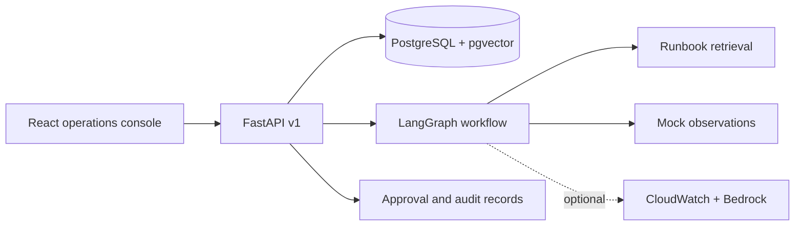
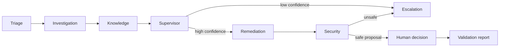

# AegisOps AI

**A local-first, multi-agent incident investigation console with cited runbooks and human-approved remediation proposals.**

Cloud incident response often starts with scattered alerts, logs, deployment notes, and runbooks. AegisOps AI brings those signals into a traceable workflow. The local demo is synthetic and requires no AWS account or paid model. It is an engineering portfolio project, **not a production incident controller**.

## What it does

- Creates and persists incidents, events, agent runs, steps, proposals, decisions, reports, and audit records.
- Runs seven agent roles in a real LangGraph graph with conditional routing and a bounded execution limit.
- Finds relevant runbook chunks with deterministic local embeddings; PostgreSQL uses pgvector cosine search.
- Pauses after security review and waits for an API-driven human approval or rejection.
- Displays evidence, citations, trace steps, proposal risk, and a clearly labeled simulated outcome. Bedrock approvals remain marked `needs_verification` until an operator checks real recovery.
- Optionally asks Claude through Amazon Bedrock for a structured root-cause hypothesis based on supplied evidence or read-only CloudWatch logs.

## Architecture





The **supervisor** routes by evidence confidence. **Triage** classifies severity and service. **Investigation** correlates log evidence and forms a hypothesis. **Knowledge** supplies cited runbook excerpts. **Remediation** writes a proposal only. **Security** blocks known destructive language and requires review. **Validation** records a simulated result in demo mode; in Bedrock mode it explicitly leaves recovery unverified. The graph has a recursion limit of 16. Run state is stored in the database and passed back to the graph after a decision.

## Stack and layout

| Layer | Technology |
| --- | --- |
| UI | React 18, TypeScript, Vite, Tailwind CSS, React Router, TanStack Query, Recharts |
| API | Python 3.11+, FastAPI, Pydantic v2, SQLAlchemy 2, Alembic |
| Workflow | LangGraph with structured shared state |
| Data | PostgreSQL 16, pgvector; SQLite for isolated tests |
| Optional cloud | Boto3 CloudWatch read calls and Bedrock runtime |
| Quality | pytest, Vitest, ESLint, Ruff, GitHub Actions |

`frontend/` contains the dashboard, `backend/` contains the API, graph, services, models, and migrations, `data/` holds synthetic examples, `infrastructure/` holds the read-only IAM example, and `docs/` has deeper design notes.

## Prerequisites and quick start

Install Docker Desktop with Compose. On Windows, start Docker Desktop before running Compose. Ports **5173** and **8000** must be free.

```bash
git clone https://github.com/kushalsrirangam/aegisops-ai.git
cd aegisops-ai
cp .env.example .env
docker compose up --build
```

PowerShell:

```powershell
git clone https://github.com/kushalsrirangam/aegisops-ai.git
Set-Location aegisops-ai
Copy-Item .env.example .env
docker compose up --build
```

The frontend is at [http://localhost:5173](http://localhost:5173), the API at [http://localhost:8000](http://localhost:8000), and Swagger at [http://localhost:8000/docs](http://localhost:8000/docs). The backend applies the initial migration and loads one synthetic incident and runbook on startup. Open the seeded incident, select **Run investigation**, review the trace and proposal, then approve or reject it. Both paths persist a report. `docker compose down` stops services; `docker compose down -v` also removes local database data.

## Configuration

`.env.example` documents `DATABASE_URL`, `APP_MODE`, `AWS_REGION`, `BEDROCK_MODEL_ID`, and `CORS_ORIGINS`. Compose supplies local database values directly. No secrets are required for demo mode. Do not commit `.env`.

For backend development outside Docker, use a PostgreSQL URL for the `db` service on a published port, or use `DATABASE_URL=sqlite:///./aegisops.db` for lightweight local work. From `backend/`:

```bash
python -m venv .venv
# Activate the virtual environment for your shell.
pip install -e '.[dev]'
alembic upgrade head
python -m app.seed
uvicorn app.main:app --reload
```

From `frontend/`:

```bash
npm ci
npm run dev
```

Vite proxies `/api` to `localhost:8000`. For a standalone frontend production build, use `npm run build`.

## Sample API requests

```bash
curl http://localhost:8000/api/v1/incidents
curl -X POST http://localhost:8000/api/v1/incidents/1/analyze
curl http://localhost:8000/api/v1/agents/runs/1
curl http://localhost:8000/api/v1/incidents/1/proposal
curl -X POST http://localhost:8000/api/v1/approvals/1/approve \
  -H 'Content-Type: application/json' -d '{"actor":"local-operator","reason":"Reviewed runbook"}'
curl http://localhost:8000/api/v1/incidents/1/report
```

Use `/reject` instead of `/approve` for the rejection path. The API also supports incident filters and pagination, runbook ingestion and search, timeline, agent catalog, and summary metrics. See [API reference](docs/api-reference.md) or Swagger for schemas.

## Tests and evaluation

```bash
cd backend
ruff check app tests
python -m compileall -q app
pytest -q
cd ../frontend
npm run lint
npm test
npm run build
cd ..
docker compose config
```

Tests cover graph routes, confidence escalation, blocked operations, cited retrieval, incident API, approval and rejection, failure responses, and a key UI disclosure. [Evaluation notes](docs/evaluation.md) describe what these tests do and do not prove.

## Bedrock and AWS

Set `APP_MODE=bedrock` for a separate deployment of the backend, configure `AWS_REGION`, `BEDROCK_MODEL_ID`, and AWS credentials through standard AWS environment or role-based resolution. Grant only `bedrock:InvokeModel` for the selected model and `logs:FilterLogEvents` for configured groups; see the [IAM example](infrastructure/terraform/read-only-policy.json). CloudWatch lookup targets `/ecs/aegisops/<service>`. You can supply logs in the incident evidence to avoid that lookup. Bedrock is used for the investigation hypothesis; the other agents currently remain deterministic. Bedrock mode **does not verify recovery** or modify AWS resources. Model access, availability, cost, and permissions are the operator's responsibility.

## Security and approval model

This local demo has **no authentication or per-user authorization**. Do not expose it publicly. API input is validated; model outputs are schema checked; retrieved runbooks are treated as data; AWS access is read-only; agents never execute shell or infrastructure operations. Approval creates an audit record and advances report generation, never a deployment. The security agent uses a basic denylist, which is not a production policy engine. See [security](docs/security.md).

## Demo versus production

| Capability | Current state |
| --- | --- |
| Local seeded scenario and full approval flow | Implemented |
| Persistent incidents, runs, approvals, reports | Implemented in PostgreSQL via Compose |
| Cited runbook retrieval | Implemented; deterministic embedding quality is limited |
| Bedrock hypothesis | Optional integration; requires AWS access |
| CloudWatch logs | Optional read-only integration; fixed log group convention |
| Live CloudWatch metric mapping | Not implemented |
| Production authentication, RBAC, rate limits | Not implemented |
| Durable LangGraph checkpoint store | Run state is persisted relationally and rehydrated; native LangGraph checkpointing is not implemented |
| ECS/Fargate Terraform deployment | IAM policy generation module only; no deployable application stack |

## Deployment approach and next steps

The [deployment guide](docs/deployment.md) outlines the required VPC, ECS/Fargate, RDS pgvector, secret storage, and IAM boundaries. A production milestone should add authentication/RBAC and a durable LangGraph checkpoint backend, then replace the simple security denylist with reviewed policy rules. No Terraform apply or deployment is triggered by this repository.

See [architecture](docs/architecture.md), [workflow](docs/agent-workflows.md), [getting started](docs/getting-started.md), [troubleshooting](docs/troubleshooting.md), and [evaluation](docs/evaluation.md).

## License

[MIT](LICENSE).
